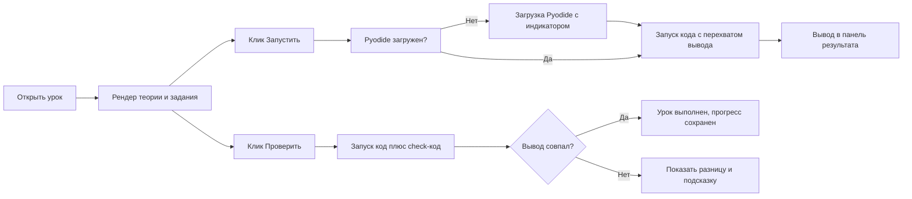

# План: freeCodeCamp-аналог по Python в одном файле index.html

## Цель
Одностраничное приложение-курс (аналог freeCodeCamp) с полным курсом Python, целиком в одном файле `index.html` (HTML + CSS + JS). Единственная внешняя зависимость — Pyodide с CDN — для выполнения настоящего Python в браузере.

## Ключевые решения

1. **Выполнение Python**: Pyodide v0.25+ (`https://cdn.jsdelivr.net/pyodide/v0.25.0/full/pyodide.js`). Реальный Python в браузере. Первая загрузка ~10–15 МБ — показываем анимацию загрузки.
2. **Защита от зависаний**: `sys.settrace` с лимитом исполненных строк (≈200 000) → прерывание с понятной ошибкой вместо бесконечного цикла, который «вешает» браузер.
3. **Поддержка `input()`**: у урока может быть очередь значений `inputData`; подменяем `builtins.input`, значения выдаются по очереди.
4. **Проверка заданий**: запускаем «код пользователя + скрытый check-код», сравниваем очищенный stdout с ожидаемым. Единый механизм для всех типов задач (вывод, функции, мини-проекты). Кнопки: «Запустить», «Проверить», «Показать решение», подсказка.
5. **Прогресс**: `localStorage` (ключ `python-course-progress`), прогресс-бар в шапке, галочки в сайдбаре, кнопки Next / Prev.
6. **Тема**: тёмная, в стиле freeCodeCamp (фон `#0a0a23`, акцент `#f1be32`, зелёный при успехе).
7. **Подсветка синтаксиса**: лёгкий токенайзер для примеров кода; в редакторе — приём «textarea + зеркальный pre с подсветкой» (прозрачный текст поверх highlighted).

## Структура курса (9 разделов, ~30 уроков, на русском)

| Раздел | Уроки |
|---|---|
| 1. Введение | Что такое Python и `print()`; переменные и типы; `input()` и преобразование типов |
| 2. Числа | Арифметика; деление `/ // %`, степень; встроенные функции `abs, round, min, max, sum` |
| 3. Строки | Индексы и срезы; методы строк; f-строки |
| 4. Структуры данных | Списки; кортежи и множества; словари; `in`, срезы списков |
| 5. Управление | `if/elif/else`; `for` и `range`; `while`, `break`, `continue` |
| 6. Функции | `def` и `return`; аргументы, `*args/**kwargs`, значения по умолчанию; `lambda` |
| 7. Продвинутое | Comprehensions; `map/filter/sorted/any/all`; `try/except`; модули и импорты |
| 8. ООП | Классы и `__init__`; методы; наследование и магические методы |
| 9. Проекты | Калькулятор; «Угадай число» с `random`; FizzBuzz; итоговый тест |

Урок ≈ блоки теории (`p`, код-пример, заметка) + задание (условие, стартовый код, hidden check-код, ожидаемый вывод, решение, подсказка).

## Архитектура внутри файла

- `header` — название, прогресс-бар, счётчик «N из M».
- `aside` — навигация по разделам (сворачиваемые группы) и урокам (галочки).
- `main` — теория + панель задания: редактор, кнопки «Запустить / Проверить / Решение», блок вывода.
- `script` — модули:
  - `COURSE` — данные курса (секции, уроки, задания);
  - `progress` — чтение/запись localStorage, счётчик;
  - `nav` — переключение уроков, Next/Prev, клавиатура (←/→), скролл наверх;
  - `runner` — ленивая загрузка Pyodide, перехват stdout/stderr, очередь input, line-limit;
  - `verify` — сравнение вывода с ожидаемым, отметка выполнения;
  - `highlight` — подсветка примеров и зеркальный предпросмотр редактора.

## Порядок реализации

1. Скелет `index.html`: шапка, сайдбар, область урока, панель редактора.
2. CSS: тёмная тема fCC, адаптивность (мобильная: сайдбар-бургер, редактор под контентом), анимации.
3. Данные курса: 9 разделов / ~30 уроков с теорией и заданиями на русском.
4. Раннер Pyodide: ленивая загрузка, перехват stdout/stderr, `input()`-очередь, лимит строк.
5. Проверка решений: expected-output, check-код, кнопки «Проверить» и «Решение», подсказки.
6. Прогресс в localStorage + прогресс-бар + галочки.
7. Навигация: Next/Prev, клавиатура, сворачивание разделов, скролл наверх.
8. Подсветка синтаксиса: примеры + зеркальный редактор.
9. Финальная проверка: все задания проходят, мобильная вёрстка, обработка ошибок.

## Риски и решения

- Бесконечный цикл → трассировка-лимит (sys.settrace).
- `input()` в браузере → очередь значений из данных урока.
- Нет интернета / CDN недоступен → показать понятное сообщение (Pyodide обязателен).
- Большой объём данных → единообразный шаблон урока, генерация теории из данных.